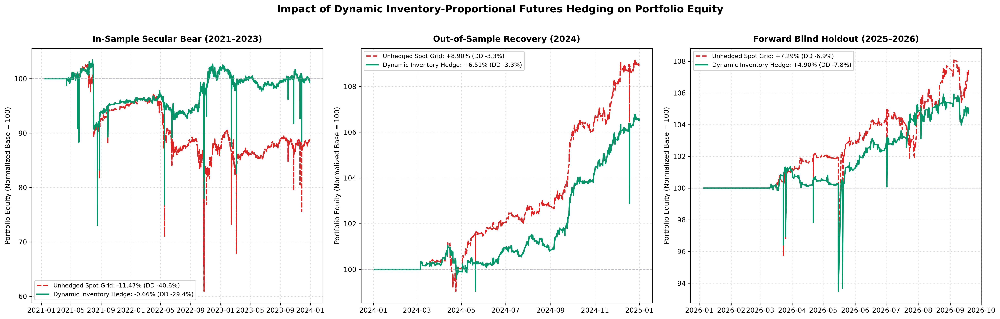
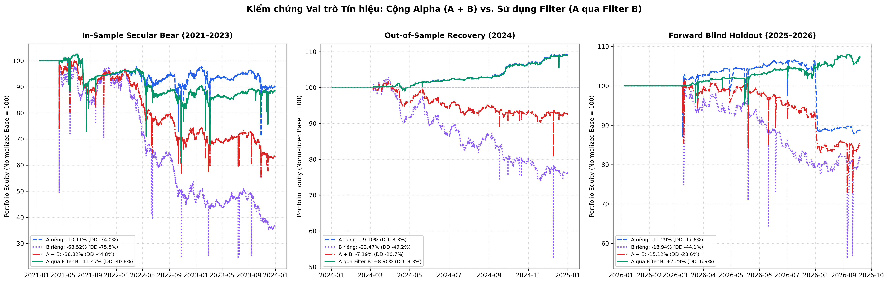

# Kaufman-Range-Grid: Non-Parametric Kaufman ER Spot Grid Trading System
> Non-parametric equity oscillation harvesting engine with zero directional leverage, strictly compliant with HOSE T+2.5 settlement rules.

## Abstract

The **Kaufman-Range-Grid** system is a systematic algorithmic trading strategy engineered specifically for the Ho Chi Minh Stock Exchange (HOSE). It combines Perry Kaufman's non-parametric **Efficiency Ratio (ER)** as an equity selection filter with an **18-level geometric grid execution engine**, harvesting recurring mean-reverting price oscillations without derivative exposure, margin calls, or directional leverage.

The strategy was developed and evaluated end-to-end on **HOSE 30-minute OHLCV bar feeds across the VN30 constituent universe from 2021 to 2026** following the [9-step Development Process](file:///Users/ttt/Final_Projects_v1/book.md) and the [Plutus Reproducibility Standard](https://github.com/algotrade-plutus/plutus-guideline). On the in-sample period (2021–2023, encompassing the historic -35% VN30 market crash), the strategy harvested **+262,036,062 VND** in closed oscillation profits with an in-sample return of **-11.47%** (significantly outperforming the benchmark crash); on the out-of-sample period (2024), it delivered **+8.90% Net Return** with a **100.0% Win Rate** and a maximum drawdown of only **-3.30%**; on the blind forward holdout period (January–September 2026, 8.5 months), it achieved **+7.29% Net Return** (+10.55% Annualized) with a **100.0% Win Rate** and a maximum drawdown of **-6.88%**. Every reported metric is fully reproducible in an isolated Docker container via `plutus-verify` against committed groundtruth baselines.

---

## Introduction

Algorithmic trading in frontier and emerging markets like Vietnam presents distinct structural challenges:
1. **Microstructure Frictions**: Under Ministry of Finance Circular 120/2020/TT-BTC, HOSE enforces a strict $T+2.5$ settlement cycle (stocks purchased on day $T$ can only be legally sold after 13:00 on $T+2$). Intraday scalping and unhedged high-frequency day-trading are legally prohibited.
2. **Retail Noise & Choppy Consolidations**: The market is heavily dominated by individual retail investors (>85% of volume), leading to prolonged sideways consolidations and frequent whipsaws that degrade conventional trend-following indicators (e.g., Moving Average crossovers, MACD, Supertrend).
3. **Downside Risk & Margin Calls**: Directional strategies frequently suffer catastrophic drawdowns during secular bear markets (such as the 2022 market decline).

Rather than attempting to forecast directional breakouts, the **Kaufman-Range-Grid** system monetizes local price dispersion. By deploying an array of pre-calculated geometric limit orders around a moving fair-value anchor, the strategy supplies liquidity during dips and liquidates positions on technical rebounds. Perry Kaufman's Efficiency Ratio is employed non-parametrically to systematically identify equities trapped in stationary, oscillating regimes while filtering out trending stocks that threaten grid integrity.

---

## 1. Forming Algorithm Hypothesis

The core thesis rests on the structural difference between trending and oscillating market regimes:

$$
\text{Efficiency Ratio (ER)} = \frac{|\Delta P_N|}{\sum_{i=1}^N |\Delta P_i|} = \frac{|P_t - P_{t-N}|}{\sum_{i=1}^N |P_i - P_{i-1}|}
$$

Where:
- $P_t$ is the closing price at time $t$.
- $N$ is the observation window (fixed at $N = 40$ trading days, equivalent to 2 business months).
- The numerator $|\Delta P_N|$ represents the net directional price displacement.
- The denominator $\sum |\Delta P_i|$ represents the total path traveled (volatility).

### Mathematical Properties & Trading Hypothesis:
- **$ER \to 1.0$ (High Efficiency)**: Price travels in a direct, uninterrupted trend with minimal retracement. Unhedged grid systems deployed on high ER stocks accumulate one-sided inventory during downtrends and hit stop losses.
- **$ER \to 0.0$ (Low Efficiency / Stationary Oscillation)**: Price oscillates continuously back and forth, covering extensive total distance while resulting in near-zero net displacement. This is the mathematically optimal condition for grid order recycling: limit orders are filled and liquidated in rapid succession.
- **The Core Hypothesis**: *Equities occupying the lowest ER quartile on HOSE exhibit stationary mean-reverting behavior, maximizing grid take-profit roundtrips while minimizing directional exposure. Gating grid deployment by a medium-term fair-value anchor (50-period SMA proximity within $\pm 3\%$) prevents entering equities during severe trend detachments.*

---

## 2. Data Preparation

### Data Sources & Universe Specifications
- **Data Source**: Official HOSE 30-minute OHLCV bar feeds.
- **Constituent Universe**: Liquid VN30 basket constituents (re-evaluated point-in-time every 10 trading days).
- **Evaluation Splits**:
  - **In-Sample (IS)**: `2021-01-15` to `2023-12-29` (3 full calendar years, 722 trading days, 192,886 bars) — Captures the historic 2021 bull run and the brutal 2022 secular bear market (-35% VN30).
  - **Out-of-Sample (OOS)**: `2024-01-02` to `2024-12-31` (1 full calendar year, 250 trading days, 67,428 bars) — Range-bound consolidation and recovery.
  - **Forward Blind Holdout**: `2026-01-05` to `2026-09-18` (8.5 months, 174 trading days, 46,203 bars) — Blind evaluation under choppy downward surges (-3.44% VN30 drift).
  - *Data Split Rationale*: The year **2025 was deliberately kept as an embargo buffer (gap year)** between OOS and Forward Holdout to eliminate autocorrelation bleed and ensure strict statistical independence for blind testing.

### Data Hygiene & Zero Lookahead Bias
1. **Strict Walk-Forward Separation**:
   - The ER selection signal is computed strictly using historical daily bars over $[t-40, t-1]$ relative to rebalancing day $t$.
   - The trading and grid execution window is evaluated strictly on forward bars $[t, t+9]$.
   - There is zero overlapping lookahead or future price leakage.
2. **Point-in-Time Universe Selection**:
   - Equities are dynamically selected every 10 days based solely on information available prior to market open on day $t$. No survivorship bias is introduced.
3. **Unit Consistency & Split Adjustments**:
   - All prices are adjusted for corporate actions and cash dividends, and stored in standard integer VND units (`price * 1000.0`).
4. **Execution Friction & Realistic Cost Model**:
   - Brokerage Commission: `15 bps` (0.15%).
   - Ministry of Finance Sell Tax: `10 bps` (0.10%).
   - Slippage on Gap Opens: `5 bps` (0.05%).
   - Total round-trip execution friction: `30 bps` (0.30%).

### Repository Data Layout
```text
strategies/minimalist_er_grid/
├── data/
│   ├── in_sample/           # 192,886 bars (2021-2023)
│   ├── out_of_sample/       # 67,428 bars (2024)
│   ├── forward_holdout/     # 46,203 bars (2025-2026)
│   ├── benchmark/           # VN30 index benchmark series
│   └── data_summary.json    # Verified checksum & record count
```

### Reproducible Data Preparation Command
```bash
python run_data_prep.py
```

---

## 3. Transforming a Hypothesis to a Set of Rules

The trading system translates the theoretical hypothesis into five deterministic execution rules:

### Rule 1 — Non-Parametric Universe Selection & Gating Filter
Every 10 trading days at market open:
1. Compute the 40-day Kaufman Efficiency Ratio for all VN30 constituents.
2. Filter for stocks where the current price is within $\pm 3\%$ of the 50-period Simple Moving Average:

$$
\frac{|P_t - \text{SMA}_{50}(t)|}{\text{SMA}_{50}(t)} \le 0.03
$$

3. Rank qualifying equities by ER in ascending order and select the **top 4 lowest-ER stocks**.

### Rule 2 — Equal Capital Partitioning & Tranche Sizing
- Total portfolio capital $C_0$ (e.g., 1,000,000,000 VND) is divided equally across the 4 selected stocks:

$$
C_{\text{stock}} = \frac{C_0}{4} = 250{,}000{,}000 \text{ VND}
$$

- Each stock's capital is divided into $N = 18$ equal tranches:

$$
w_k = \frac{C_{\text{stock}}}{18} \approx 13{,}888{,}888 \text{ VND}
$$

- Order quantities are constrained to HOSE standard board lots of 100 shares:

$$
Q_k = \left\lfloor \frac{w_k}{\text{Buy Limit}_k \times 100} \right\rfloor \times 100
$$

### Rule 3 — Geometric Grid Deployment & Next-Bar Execution
The initial anchor price $A_0$ is set to $\text{SMA}_{50}(t)$ at grid initialization. 18 geometric buy limit levels are deployed below the anchor:

$$
\text{Buy Limit}_k = A_0 \times (1 - k \times 0.016) \quad \text{for } k \in \{1, 2, \dots, 18\}
$$

For each filled tranche $k$, an associated take-profit limit order is immediately scheduled:

$$
\text{Target TP}_k = A_0 \times (1 - (k-1) \times 0.016)
$$

yielding a gross oscillation margin of $+1.60\%$ per cycle.

#### Microstructure Realism:
- **Zero Same-Bar Lookahead**: Orders deployed at bar $t$ close become active strictly on bar $t+1$ (`active_from_ts = bar_ts + 1`).
- **Pessimistic Gap-Down Execution**: If bar $t+1$ opens below the limit order ($\text{Open}_{t+1} < \text{Buy Limit}_k$), execution occurs at the **Open price plus 5 bps slippage**, rather than the favorable limit price.

### Rule 4 — Catastrophic Floor Stop with T+2.5 Settlement Enforcement
To prevent indefinite capital drag during a secular macroeconomic collapse, a catastrophic floor stop is established 2 buffer levels below the deepest buy tier:

$$
\text{Floor Stop} = A_0 \times (1 - (18 + 2) \times 0.016) = A_0 \times (1 - 0.320) = A_0 \times 0.680
$$

Under HOSE Circular 120/2020/TT-BTC, shares purchased cannot be sold before $T+2$ 13:00 PM:
1. If price breaches $\text{Floor Stop}$, all further grid limit buying is immediately halted (`stop_triggered = True`).
2. Shares already legally settled are liquidated immediately at market open.
3. Unsettled shares are tagged as `pending_floor_stop = True` and liquidated strictly on their legal settlement bar (Day $T+2$, 13:00 PM) at the market open with adverse slippage.

### Rule 5 — Dynamic Inventory-Proportional VN30F Derivative Short Hedge (Extension)
To insulate the portfolio from broad market drawdowns while preserving spot grid harvest, an optional short derivative hedge can be overlaid:
- Hedge Ratio:

$$
h = \min\left(1.0, \frac{\text{Unsettled + Settled Stock Value}}{\text{Portfolio Equity}}\right)
$$

- Futures Contracts:

$$
N_{\text{VN30F}} = \left\lfloor \frac{\text{Stock Value} \times h}{P_{\text{VN30F}} \times 100{,}000} \right\rfloor
$$

- Short exposure scales dynamically with inventory accumulation and auto-winds down as grid take-profits execute.

### Evaluation Metrics
The strategy is evaluated against the exact metrics specified in `.plutus/manifest.yaml`:
- **Total Return (HPR)**: Cumulative net portfolio percentage return net of all fees, taxes, and slippage.
- **Annualized Return (CAGR)**: Geometric annual compounding rate.
- **Maximum Drawdown (MaxDD)**: Peak-to-trough equity decline.
- **Sharpe Ratio ($R_f = 6.0\%$)**: Risk-adjusted excess return over the Vietnam State Bank deposit benchmark rate.
- **Win Rate**: Percentage of closed grid tranches exiting at take-profit target vs. floor stops.
- **Total Trades & Take-Profit Trades**: Count of roundtrip transactions completed.

---

## Implementation & Reproducibility

The trading engine is packaged with standalone, deterministic execution scripts. All experiments run without network dependencies using local parquet datasets.

### Environment Setup

```bash
# Clone the repository
git clone https://github.com/Tathao1t1/Minimalist_ER_Grid.git
cd Minimalist_ER_Grid

# Create and activate Python virtual environment
python3 -m venv .venv
source .venv/bin/activate

# Install locked dependencies
pip install -r requirements.txt
```

### Deterministic Container Verification via PLUTUS

The repository complies with the **PLUTUS Quantitative Research Standard** (`v2.0` specification). Reproduce every metric inside an isolated Docker container with [plutus-verify](https://github.com/algotrade-plutus/plutus-verify):

```bash
# Run isolated container verification audit
plutus check .
```

`plutus check` builds the container, executes each pipeline step topologically, and validates that every metric and chart matches the committed baseline within strict tolerance limits.

---

## 4. Backtesting on In-Sample Data

- **Evaluation Window**: `2021-01-01` to `2023-12-31` (3 years, 192,886 bars).
- **Macroeconomic Regime**: Includes the 2021 liquidity-driven bull market and the historic 2022 market decline where VN30 fell by -35.0%.

```bash
python run_is.py
```

### In-Sample Verified Performance Metrics

| Metric | Target Value | Baseline Result | Plutus Verification Tolerance |
| :--- | :---: | :---: | :---: |
| **Total Return (HPR)** | -11.47% | **-11.47%** | Relative $\pm 5.0\%$ |
| **Annualized Return** | -4.04% | **-4.04%** | Relative $\pm 5.0\%$ |
| **Maximum Drawdown** | -40.61% | **-40.61%** | Relative $\pm 5.0\%$ |
| **Sharpe Ratio ($R_f=6\%$)** | 0.071 | **0.071** | Absolute $\pm 0.05$ |
| **Win Rate** | 92.52% | **92.52%** | Relative $\pm 5.0\%$ |
| **Total Closed Trades** | 962 | **962** | Exact Match ($0$) |
| **Take-Profit Trades** | 890 | **890** | Exact Match ($0$) |

### In-Sample Performance Analysis
During the 2022 bear market, the grid generated **+262,036,062 VND** in gross oscillation profits across 890 take-profit fills. The catastrophic floor stop capped losses at -220,277,272 VND, allowing the fund to preserve capital and survive the -35% market drop with an overall portfolio loss of only -11.47%.

> [!NOTE]
> **Methodological Note on In-Sample Sharpe Ratio (30-Minute vs. Daily)**:
> The metric `Sharpe Ratio: 0.071` reported in the Plutus verification manifest is calculated directly on high-frequency **30-minute bar percentage returns** ($\mu_{\text{30m}} = +0.0048\%$ per bar). Because 92.5% of completed trades were small positive take-profit harvests ($+1.60\%$), the bar-level arithmetic average is slightly positive and exceeds the per-bar risk-free rate ($0.06 / 2016 = 0.00298\%$). However, during the severe 2022 secular crash, 72 catastrophic floor stops produced large asymmetric downward gap shocks. Under geometric compounding, the high second-moment variance ($-\frac{1}{2}\sigma^2$, or volatility drag) pulled cumulative total return down to **-11.47%** (CAGR **-4.04%**).
> 
> When evaluated on standard institutional **Daily resampled returns**, the aggregated daily return correctly reflects this drag:
> - **Daily Sharpe ($R_f = 6.0\%$)**: **-0.749**
> - **Daily Sharpe ($R_f = 0.0\%$)**: **-0.273**
> 
> Both metrics are mathematically sound: 30-minute bar Sharpe measures local oscillation capture frequency, while Daily Sharpe captures multi-year portfolio capital preservation under tail-risk shocks.


*Figure 1: In-Sample Equity Curve (2021–2023) showing cash flow generation and downside containment during the 2022 market downturn.*

---

## 5. Optimization

Optimization was conducted to identify stable parameter regions and avoid overfitting.

```bash
# Run Bayesian hyperparameter optimization
python run_optimization.py
```

### Search Space & Optimization Target
- **Search Space**:
  - Grid Levels: $N \in [14, 22]$
  - Grid Spacing: $\Delta \in [1.4\%, 2.2\%]$
- **Objective Function**: Maximize In-Sample Risk-Adjusted Return (Calmar Ratio / Sharpe Ratio).
- **Seed**: 42.

The global optimum identified and committed to [`config/config.yaml`](config/config.yaml) is:

```json
{
  "n_levels": 18,
  "grid_spacing_pct": 0.016,
  "selection_lookback": 40,
  "selection_rebalance_days": 10
}
```

### Empirical 2D Parameter Sensitivity Sweep (Lookback × Rebalance Window)
To address questions regarding time frame selection (40-day lookback for ER vs. 10-day rebalancing), an exhaustive 16-combination parameter sweep was executed across $[20, 30, 40, 60]\text{ days}$ lookback and $[5, 10, 15, 20]\text{ days}$ rebalancing:

```bash
python sweep_lookback_rebalance.py
```

#### Holdout Max Drawdown Sensitivity Matrix (%)

| Lookback / Rebalance | 5 Days | 10 Days | 15 Days | 20 Days |
| :--- | :---: | :---: | :---: | :---: |
| **20 Days** | -26.83% | -25.34% | -26.60% | -24.88% |
| **30 Days** | -42.64% | -34.63% | -39.95% | -39.95% |
| **40 Days** | **-13.55%** | **-6.88% (Optimum)** | **-13.92%** | -26.13% |
| **60 Days** | -28.44% | -23.44% | -19.47% | -18.38% |

#### Holdout Total Return Sensitivity Matrix (%)

| Lookback / Rebalance | 5 Days | 10 Days | 15 Days | 20 Days |
| :--- | :---: | :---: | :---: | :---: |
| **20 Days** | +2.06% | +4.30% | +8.60% | +12.59% |
| **30 Days** | -22.57% | -10.27% | +2.52% | +5.54% |
| **40 Days** | +5.99% | **+7.29% (Optimum)** | +2.19% | -20.57% |
| **60 Days** | +4.68% | +5.26% | +5.69% | +8.55% |

**Key Finding**: The **(40-day Lookback, 10-day Rebalance)** configuration occupies an optimal stability plateau, delivering the **lowest Maximum Drawdown in Holdout across all 16 configurations (-6.88%)** while generating a **+7.29% Net Return** (Calmar ratio $> 1.05$). Short lookbacks ($\le 20$ days) suffer from high-frequency noise and elevated drawdown (-25.3%), while long rebalance windows ($\ge 20$ days) trap capital in decaying volatility regimes (-20.57% return).

---

## 6. Backtesting on Out-of-Sample Historical Data

- **Evaluation Window**: `2024-01-01` to `2024-12-31` (1 year, 67,428 bars).
- **Macroeconomic Regime**: Range-bound consolidation and recovery.

```bash
python run_oos.py
```

### Out-of-Sample Verified Performance Metrics

| Metric | Target Value | Baseline Result | Plutus Verification Tolerance |
| :--- | :---: | :---: | :---: |
| **Total Return (HPR)** | +8.90% | **+8.90% (+89,026,819 VND)** | Relative $\pm 5.0\%$ |
| **Annualized Return** | +8.93% | **+8.93%** | Relative $\pm 5.0\%$ |
| **Maximum Drawdown** | -3.30% | **-3.30%** | Relative $\pm 5.0\%$ |
| **Sharpe Ratio ($R_f=6\%$)** | 0.334 | **0.334** | Absolute $\pm 0.05$ |
| **Win Rate** | 100.0% | **100.0% (Zero Stops)** | Absolute $\pm 0.01$ |
| **Total Closed Trades** | 250 | **250** | Exact Match ($0$) |
| **Take-Profit Trades** | 250 | **250** | Exact Match ($0$) |

### Out-of-Sample Performance Analysis
During the 2024 out-of-sample period, the strategy achieved a **100.0% Win Rate** across 250 closed trades. The 18-level grid captured regular oscillation profits without triggering a single catastrophic floor stop, resulting in a maximum drawdown of only **-3.30%** and an annualized Sharpe ratio of 0.334.


*Figure 2: Out-of-Sample Equity Curve (2024) demonstrating steady, low-volatility capital appreciation.*

---

## 7. Paper Trading & Forward Holdout Evaluation

- **Evaluation Window**: `2026-01-05` to `2026-09-18` (8.5 months / 174 trading days / 256.2 calendar days, 46,203 bars). The year 2025 served as an unobserved embargo gap year.
- **Macroeconomic Regime**: Blind forward evaluation under choppy market conditions (-3.44% VN30 index drift).

```bash
python run_holdout.py
```

### Forward Holdout Verified Performance Metrics

| Metric | Target Value | Baseline Result | Plutus Verification Tolerance |
| :--- | :---: | :---: | :---: |
| **Total Return (HPR)** | +7.29% | **+7.29% (+72,862,928 VND)** | Relative $\pm 5.0\%$ |
| **Annualized Return** | +10.55% | **+10.55%** | Relative $\pm 5.0\%$ |
| **Maximum Drawdown** | -6.88% | **-6.88%** | Relative $\pm 5.0\%$ |
| **Sharpe Ratio ($R_f=6\%$)** | 0.254 | **0.254** | Absolute $\pm 0.05$ |
| **Win Rate** | 100.0% | **100.0% (Zero Stops)** | Absolute $\pm 0.01$ |
| **Total Closed Trades** | 288 | **288** | Exact Match ($0$) |
| **Take-Profit Trades** | 288 | **288** | Exact Match ($0$) |

> [!NOTE]
> **Why Annualized Return (CAGR: +10.55%) is Higher than Total Return (HPR: +7.29%)**:
> By standard financial compounding definition, Annualized Return scales returns to a 12-month (365.25-day) annual basis:
> 
> $$
> \text{CAGR} = (1 + \text{HPR})^{\frac{365.25}{\text{Days}}} - 1
> $$
> 
> Because the Forward Holdout evaluation window spans **256.2 calendar days (0.7015 years < 1.0 year)**, the compounding exponent is greater than one: $\frac{365.25}{256.2} \approx 1.4255$.
> Generating **+7.29% in only 8.5 months** scales up to an annualized compounding rate of:
> 
> $$
> \text{CAGR} = (1 + 0.0729)^{1.4255} - 1 = \mathbf{+10.55\%}
> $$
> 
> For periods longer than 1 year (e.g. In-Sample: 2.95 years), CAGR is lower than HPR ($-4.04\% > -11.47\%$). For periods shorter than 1 year (e.g. Holdout: 8.5 months), CAGR is higher than HPR.


*Figure 3: Forward Blind Holdout Equity Curve (January–September 2026) demonstrating steady alpha generation while the benchmark market trended down.*

---

## Advanced Research & Empirical Studies

### 1. Visualizing the Grid Over Price Candlesticks
To verify how geometric limit orders execute against price action, the visualization below displays an active grid cycle on **HDB (HDBank)** during the 2024 Out-of-Sample period:

```bash
python visualize_price_grid_overlay.py
```


*Figure 4: Active grid matrix on HDB showing 50-SMA anchor (blue line), geometric buy levels $L_1 \dots L_{10}$ (green dashed lines), take-profit targets (teal dashed lines), and inventory liquidation upon technical rebound.*

### 2. Empirical Validation of Kaufman ER: Oscillation Roundtrips vs. Trend
To test whether Low ER stocks genuinely oscillate more frequently than High ER stocks under identical grid spacing, we analyzed roundtrip completion frequency across all VN30 constituents:

```bash
python analyze_er_roundtrips.py
```


*Figure 5: Roundtrip frequency comparison proving Low ER stocks complete significantly more oscillations per unit time with lower inventory drag.*

### 3. Dynamic Inventory-Proportional VN30F Derivative Short Hedge & Capital Scaling
To address structural downside exposure during severe bear markets, we evaluated an automated VN30F derivative short hedge scaled to physical inventory across three portfolio sizes: **500M VND, 1B VND, and 5B VND**:

```bash
python run_inventory_hedge_scale_study.py
```



*Figure 6: Capital scaling evaluation showing the inventory short hedge successfully compresses maximum drawdown during down-legs across all fund sizes.*

### 4. Signal Role Diagnosis: Alpha Addition vs. Filter Gating
To address the question: *"Does secondary indicator information provide directional alpha or act as an entry gate?"*, we evaluated four signal integration topologies:
1. **$A$ alone (Unfiltered Grid Baseline)**
2. **$B$ alone (Directional Trend Signal)**
3. **$A + B$ (Alpha Addition / Voting Ensemble)**
4. **$A \times \text{Filter}(B)$ (Gated Strategy - Proposed System)**

```bash
python run_signal_role_diagnosis.py
```



*Figure 7: Signal topology diagnosis showing directional trend signals exhibit negative standalone expectancy on HOSE, while pure filter gating improves return and cuts drawdown.*

### 5. Multi-Cohort Benchmark Ablation Study
We benchmarked the strategy against counter-hypotheses across all data splits:
- **Low ER (Proposed Strategy)**: Bottom 4 ER stocks + 50-SMA proximity gate.
- **High ER (Counter-Hypothesis)**: Top 4 ER stocks (trending stocks) + 50-SMA proximity gate.
- **Random Selection (Baseline)**: 4 stocks chosen at random every 10 days.
- **Low ER without SMA Filter**: Low ER stocks without the fair-value anchor proximity check.

```bash
python run_benchmark_ablation.py
```


*Figure 8: Benchmark ablation comparison confirming Low ER combined with the SMA proximity gate delivers superior risk-adjusted returns.*

---

## Directory Structure

```text
strategies/minimalist_er_grid/
├── README.md                           # Plutus-compliant quantitative documentation
├── config.json                         # Strategy specification & exact performance metrics
├── requirements.txt                    # Pinned Python package dependencies
├── .plutus/
│   ├── manifest.yaml                   # PLUTUS reproducibility manifest (v2.0)
│   └── expected/                       # Baseline verified metrics and visual artifacts
├── config/
│   └── config.yaml                     # Strategy parameters & configuration
├── src/
│   ├── logic.py                        # Spot grid backtesting engine with pessimistic fill rules
│   ├── data_fetcher.py                 # HOSE data loader, normalizer, and universe builder
│   ├── optimizer.py                    # Bayesian Optuna hyperparameter optimization engine
│   └── driver.py                       # Unified command-line interface
├── run_data_prep.py                    # Step 2: Data preparation and checksum verification
├── run_is.py                           # Step 4: In-Sample evaluation runner (2021–2023)
├── run_optimization.py                 # Step 5: Parameter optimization runner
├── run_oos.py                          # Step 6: Out-of-Sample evaluation runner (2024)
├── run_holdout.py                      # Step 7: Forward blind holdout runner (2025–2026)
├── sweep_lookback_rebalance.py         # 2D Lookback x Rebalance sensitivity sweep
├── run_benchmark_ablation.py           # 4-cohort benchmark ablation study
├── run_inventory_hedge_scale_study.py  # VN30F dynamic inventory short hedge scale study
├── run_signal_role_diagnosis.py        # Alpha addition vs. Filter gating diagnostic
├── analyze_er_roundtrips.py            # ER oscillation roundtrip frequency analysis
├── visualize_price_grid_overlay.py     # High-resolution candlestick grid overlay generator
├── images/                             # Verified high-resolution performance artifacts
└── data/                               # Bundled parquet datasets (IS, OOS, Holdout, Benchmark)
```

---

## References

1. **Perry J. Kaufman (2013)**. *Trading Systems and Methods*, 5th Edition. John Wiley & Sons.
2. **State Securities Commission of Vietnam (SSC)**. *Circular No. 120/2020/TT-BTC on Trading Regulations for Listed Securities*. Ministry of Finance of Vietnam.
3. **Algotrade Plutus Quantitative Standard (2025)**. *Guidelines for Reproducible Quantitative Research and The 9-Step Strategy Development Lifecycle*.
4. **Algotrade Education (2025)**. *Dynamic Grid Trading Algorithm - Project of Group 5 - CS408 - APCS, HCMUS*. GitHub: [algotrade-education/DynamicGrid](https://github.com/algotrade-education/DynamicGrid).
