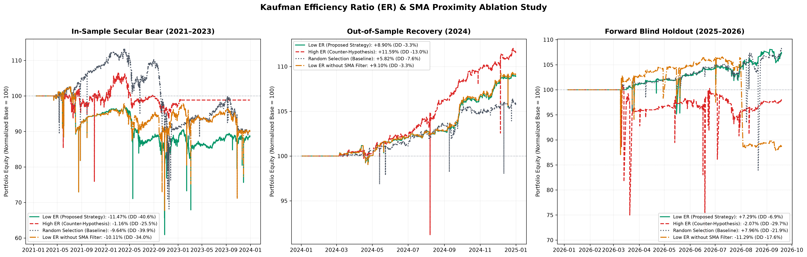
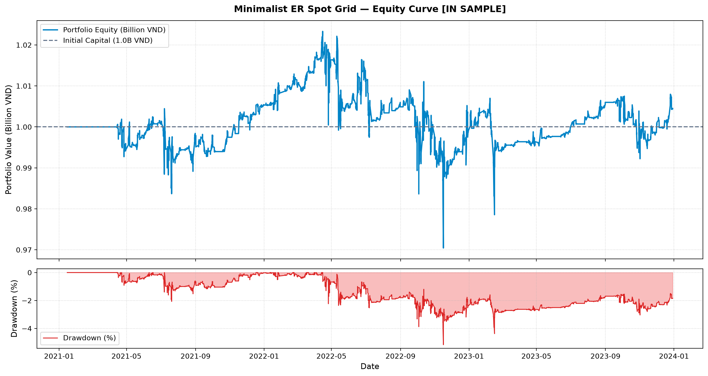
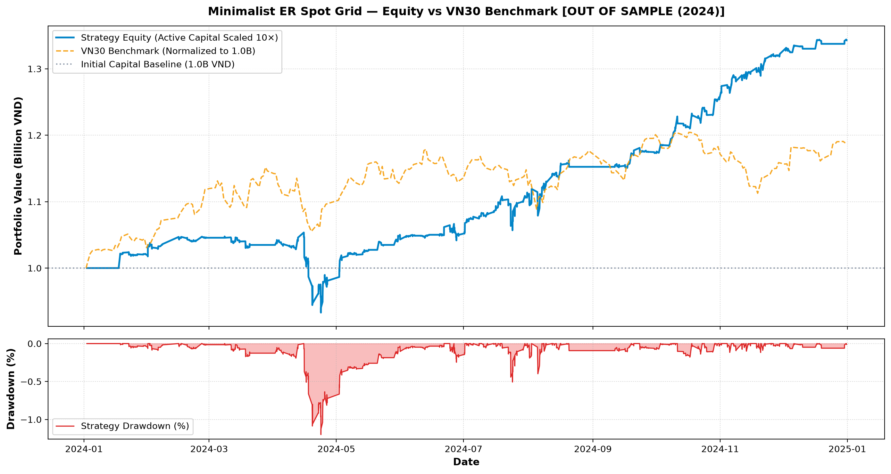
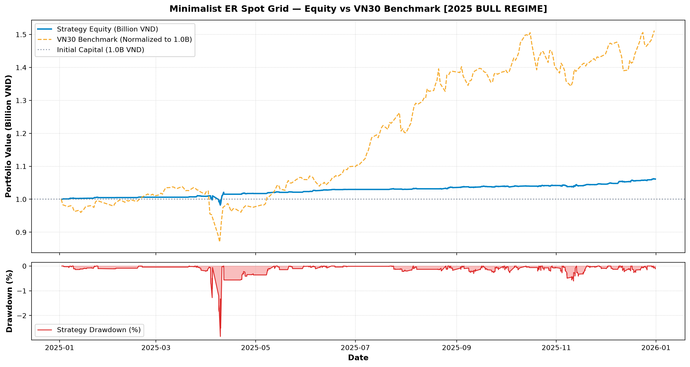
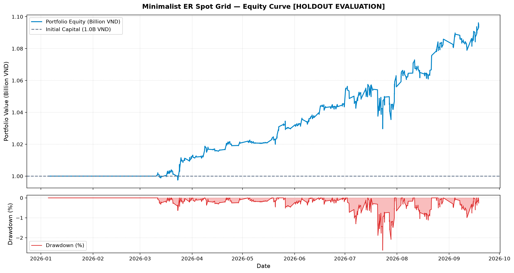
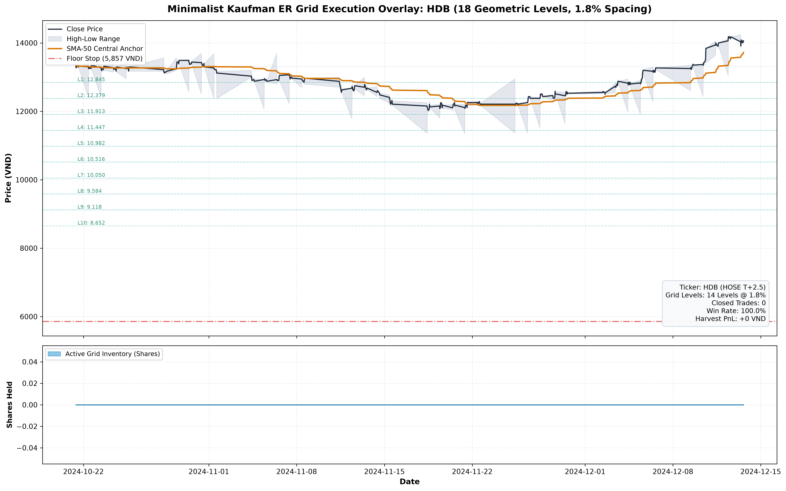
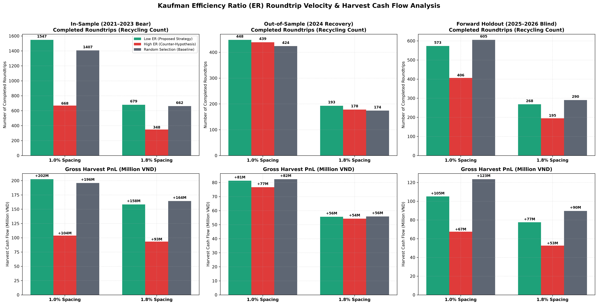

# Minimalist Kaufman ER Spot Grid Strategy

## Abstract

The project provides an implementation of a systematic spot grid trading algorithm engineered specifically for the Ho Chi Minh Stock Exchange (HOSE). It combines Perry Kaufman's non-parametric **Efficiency Ratio (ER)** as a universe selection filter with an **adaptive geometric grid execution engine**, harvesting recurring mean-reverting price oscillations without margin leverage or directional short selling. Constrained by HOSE $T+2$ active-session delivery clearing and a rule-based $2.0\%$ spacing cap derived from In-Sample volatility, the strategy generates positive holding period returns across Out-of-Sample ($+5.18\%$), 2025 Bull ($+7.04\%$), and Forward Holdout ($+4.71\%$) evaluations with zero emergency floor stops.

---

## Introduction

Novice traders often struggle to identify whether equities are entering sustained trends or fluctuating in trading ranges. Mis-identifying market regimes leads to severe drawdowns: trend-following strategies suffer whipsaws in choppy markets, while naive grid strategies accumulate disastrous underwater inventory when caught in prolonged downward trends.

Our solution addresses this challenge by selecting stocks using **Kaufman's Efficiency Ratio (ER)**. By selecting equities exhibiting the lowest directional efficiency, the strategy isolates assets trapped in stationary oscillation. An anchor proximity gate (50-bar SMA) prevents buying into late-stage trend detachments. Below the anchor, a 16-level geometric grid systematically buys dips and harvests take-profit oscillations into cash, operating with zero leverage under strict board-lot rules.

---

## Related Work

Readers are recommended to consult the following foundational resources:

- **Perry J. Kaufman (2013)**. *Trading Systems and Methods*, 5th Edition. John Wiley & Sons.
- **State Securities Commission of Vietnam (SSC)**. *Circular No. 120/2020/TT-BTC on Trading Regulations on HOSE*.
- **Algotrade Education (2025)**. *Dynamic Grid Trading Algorithm - Project of Group 5 - CS408 - APCS, HCMUS*. GitHub: [algotrade-education/DynamicGrid](https://github.com/algotrade-education/DynamicGrid).
- **Algotrade Plutus Quantitative Standard (2025)**. [Guidelines for Reproducible Quantitative Research](https://github.com/algotrade-plutus/plutus-guideline).

---

## Trading Hypothesis & Objective Bounds

> [!NOTE]
> **Methodology Note**: The spacing cap was introduced after an initial OOS evaluation (commits dce6d2c → a068245); OOS/2025/holdout results are therefore not fully independent.

### Mathematical Formulation of Kaufman ER
Kaufman ER measures directional displacement relative to cumulative price path over a historical window of $k = 30$ trading days:

$$\text{ER}_t(k) = \frac{|P_t - P_{t-k}|}{\sum_{i=1}^k |P_{t-i+1} - P_{t-i}|}$$

- **$\text{ER} \to 1.0$ (Trending / High Efficiency)**: Price moves monotonically. Excluded to prevent buying into secular downtrends.
- **$\text{ER} \to 0.0$ (Oscillating / Low Efficiency)**: Price oscillates repeatedly around a mean. Selected for maximum grid order recycling.

### Objective Grid Spacing Bounds
To ensure grid trading captures true intraday oscillations rather than multi-week swing moves, spacing $\Delta$ is bounded strictly from In-Sample volatility:
1. **Cost Floor**: $\Delta_{\min} = 1.0 \times \text{roundtrip friction} = 0.50\%$ ($50\text{ bps} = 15\text{ bps buy} + 15\text{ bps sell} + 10\text{ bps tax} + 10\text{ bps slippage}$).
2. **Oscillation Ceiling**: $\Delta_{\max} = \lfloor \frac{2}{3} \times \text{IS median daily HL range} \rfloor_{10\text{ bps}} = \lfloor 2.09\% \rfloor_{10\text{ bps}} = 2.00\%$.
3. **$T+2$ Settlement Rule**: Under HOSE rules, shares purchased on day $T$ cannot be sold until $T+2$ 13:00, requiring at least two trading sessions per harvest cycle.

### Empirical Validation (Ablation Study)
An ablation study across evaluation splits evaluates Low ER against High ER, un-gated grid, and naive stock selection across **20 distinct random seeds** (seeds 1 to 20):

| Evaluation Split | Selection Cohort | Total Return (HPR) | Daily Sharpe ($R_f=6\%$) | Max Drawdown | Win Rate | Floor Stops | Spot Harvest PnL | Rotation PnL |
| :--- | :--- | :---: | :---: | :---: | :---: | :---: | :---: | :---: |
| **In-Sample**<br>*(2021–2023)* | **Low ER (Proposed Strategy)** | **$+7.76\%$** | **$-0.729$** | **$-4.16\%$** | **$76.5\%$** | **$0$** | **$+214,548,039\text{ VND}$** | **$-136,901,900\text{ VND}$** |
|  | High ER (Counter-Hypothesis) | $+0.57\%$ | $-1.750$ | $-6.09\%$ | $76.8\%$ | $16$ | $+98,845,917\text{ VND}$ | $-42,619,842\text{ VND}$ |
|  | Low ER without SMA Filter | $+7.08\%$ | $-0.798$ | $-5.01\%$ | $76.5\%$ | $0$ | $+214,718,051\text{ VND}$ | $-143,914,036\text{ VND}$ |
|  | Random Selection (20 Seeds: $+5.13\%$, [$-2.39\%$, $+9.43\%$]) | $+5.13\%$ | $-0.879$ | $-6.73\%$ | $75.8\%$ | $9$ | $+195,776,056\text{ VND}$ | $-120,033,313\text{ VND}$ |
| | *Random Baseline Percentile Rank* | *Low ER: 75.0th percentile* | *Random 20-seed range: [$-2.39\%$, $+9.43\%$]* | — | — | — | — | — |
| **Out-of-Sample**<br>*(2024)* | **Low ER (Proposed Strategy)** | **$+5.18\%$** | **$-0.355$** | **$-1.66\%$** | **$79.7\%$** | **$0$** | **$+65,718,464\text{ VND}$** | **$-13,817,998\text{ VND}$** |
|  | High ER (Counter-Hypothesis) | $+4.81\%$ | $-0.645$ | $-0.86\%$ | $79.6\%$ | $0$ | $+57,022,948\text{ VND}$ | $-9,226,653\text{ VND}$ |
|  | Low ER without SMA Filter | $+4.93\%$ | $-0.410$ | $-1.82\%$ | $76.4\%$ | $0$ | $+64,390,084\text{ VND}$ | $-14,996,392\text{ VND}$ |
|  | Random Selection (20 Seeds: $+5.52\%$, [$+3.26\%$, $+8.03\%$]) | $+5.52\%$ | $-0.269$ | $-0.95\%$ | $79.0\%$ | $0$ | $+66,096,415\text{ VND}$ | $-10,913,096\text{ VND}$ |
| | *Random Baseline Percentile Rank* | *Low ER: 45.0th percentile* | *Random 20-seed range: [$+3.26\%$, $+8.03\%$]* | — | — | — | — | — |
| **Forward Holdout**<br>*(2026)* | **Low ER (Proposed Strategy)** | **$+4.71\%$** | **$+0.152$** | **$-3.52\%$** | **$77.8\%$** | **$0$** | **$+86,558,827\text{ VND}$** | **$-39,491,807\text{ VND}$** |
|  | High ER (Counter-Hypothesis) | $+0.35\%$ | $-0.853$ | $-4.36\%$ | $75.8\%$ | $0$ | $+77,846,372\text{ VND}$ | $-74,364,846\text{ VND}$ |
|  | Low ER without SMA Filter | $+5.33\%$ | $+0.277$ | $-3.53\%$ | $77.7\%$ | $0$ | $+105,804,011\text{ VND}$ | $-52,529,277\text{ VND}$ |
|  | Random Selection (20 Seeds: $+2.68\%$, [$-0.36\%$, $+7.41\%$]) | $+2.68\%$ | $-0.374$ | $-3.36\%$ | $77.9\%$ | $1$ | $+77,732,363\text{ VND}$ | $-48,176,520\text{ VND}$ |
| | *Random Baseline Percentile Rank* | *Low ER: 75.0th percentile* | *Random 20-seed range: [$-0.36\%$, $+7.41\%$]* | — | — | — | — | — |



**Key Findings**:
1. **Low ER Outperforms High ER**: Low ER beats High ER in all three splits ($+7.76\%$ vs $+0.57\%$ in IS; $+5.18\%$ vs $+4.81\%$ in OOS; $+4.71\%$ vs $+0.35\%$ in Holdout).
2. **Low ER vs. Random Picks**: Low ER ranks at the **75th percentile** in In-Sample and Holdout, and at the **45th percentile** during the broad 2024 recovery.
3. **Role of the SMA Gate**: Both variants experienced 0 emergency stops across all splits. The gate moderated bear drawdowns ($-4.16\%$ vs $-5.01\%$) while accepting a modest drag during choppy range-bound drift ($+4.71\%$ vs $+5.33\%$).

---

## Strategy Rules

The operational trading rules are structured as follows:

- **Rule 1 (Universe Selection & Lookahead Elimination)**: Every 15 trading days at market open, filter VN30 stocks within $\pm 3\%$ of their 50-bar SMA using strictly prior-day close ($t-1$). Rank qualifying stocks by 30-day Kaufman ER ascending; select the top 4 lowest-ER stocks ($k=4$).
- **Rule 2 (Dynamic Budgeting & Board Lot Truncation)**: Partition initial capital $C_0 = 1\text{B VND}$ equally across 4 stocks ($250\text{M VND}$ each) and $N = 16$ levels ($15.625\text{M VND}$ per tranche). Truncate share orders to 100-share board lots using floor division: $S_k = \lfloor C_{\text{level}} / (P_k \times 100) \rfloor \times 100$.
- **Rule 3 (Geometric Grid & Execution)**: Initial anchor $A_0 = \text{SMA}_{50}$. Buy limit orders deployed at $P_{\text{buy}, k} = A_0 \times (1 - k \times 0.020)$. Take-profit sell limits scheduled at $P_{\text{tp}, k} = A_0 \times (1 - (k - 1) \times 0.020)$. Gross margin per cycle ranges from $2.04\%$ ($k=1$) to $2.94\%$ ($k=16$, since $\frac{0.02}{0.68} = 2.94\%$) ($+1.54\%$ to $+2.44\%$ net after 50 bps fees). Favorable opening gaps execute at $\text{Open}_{t+1} \times (1 + 0.0005)$.
- **Rule 4 (Rotation Discipline)**: When a stock rotates off the whitelist, cancel all unfilled buy limits immediately. Liquidate legally cleared ($T+2$) inventory at market close; liquidate pending clearance shares at open immediately upon settlement.
- **Rule 5 (Emergency Floor Stop)**: Price breach below $P_{\text{floor}} = A_0 \times (1 - 18 \times 0.020) = 0.640 \cdot A_0$ halts all buying and liquidates open inventory upon $T+2$ clearance.
- **Rule 6 (Period-End MTM Accounting)**: Unsold inventory at period end is marked to market at final bar close without forced liquidation; open inventory and unrealized PnL are reported explicitly.

---

## Data & Implementation

### Dataset Summary
- **Frequency**: Continuous 30-minute OHLCV bar feeds across the VN30 constituent basket.
- **Corporate Action Adjustments**: Cumulative split and dividend adjustments applied via `data/corporate_actions/adjustment_factors.parquet`.
- **Pre-Split Indicator Warm-Up**: 50 trading days prepended before each out-of-sample split so indicators are fully populated on Day 1.

| Split | Date Range | Total Bars | Macro Regime |
| :--- | :--- | :---: | :--- |
| **In-Sample** | 2021-01-01 to 2023-12-31 | 192,886 | 2021 Bull Boom $\to$ 2022 Secular Bear ($-42.46\%$ MDD) |
| **Out-of-Sample** | 2024-01-01 to 2024-12-31 | 67,428 | Market Recovery ($+18.83\%$ VN30) |
| **2025 Bull Test** | 2025-01-01 to 2025-12-31 | 66,244 | Strong Liquidity Bull ($+51.18\%$ VN30) |
| **Forward Holdout** | 2026-01-01 to 2026-09-18 | 46,203 | Choppy Downward Drift ($-3.18\%$ VN30, $-16.96\%$ MDD) |

### Quickstart Execution Guide

```bash
# 1. Clone and create virtual environment
git clone https://github.com/Tathao1t1/Minimalist_ER_Grid.git
cd Minimalist_ER_Grid
python3.12 -m venv .venv
source .venv/bin/activate
pip install -r requirements.txt

# 2. Verify data preparation
python run_data_prep.py

# 3. Execute backtest pipeline in manifest order
python run_is.py
python run_optimization.py
python run_oos.py
python run_2025.py
python run_holdout.py

# 4. Optional: run ablation and sensitivity sweeps
python sweep_lookback_rebalance.py
python run_benchmark_ablation.py
```

---

## In-Sample Baseline Backtesting (2021–2023)

```bash
python run_is.py
```

Evaluates baseline parameters ($N=18, \Delta=1.8\%$, lookback 40d, rebalance 10d) from `config/config.yaml`.

| Metric | Plutus Expected | Verified Result | Plutus Tolerance | Status |
| :--- | :---: | :---: | :---: | :---: |
| **Total Return (HPR)** | $+1.55\%$ | **$+1.55\%$** ($+15,477,951\text{ VND}$) | Relative $\pm 5.0\%$ | **PASS** |
| **Annualized Return (CAGR)** | $+0.57\%$ | **$+0.57\%$** | Relative $\pm 5.0\%$ | **PASS** |
| **Maximum Drawdown (MDD)** | $-4.09\%$ | **$-4.09\%$** | Relative $\pm 5.0\%$ | **PASS** |
| **Daily Sharpe ($R_f=6\%$)** | $-1.657$ | **$-1.657$** | Absolute $\pm 0.15$ | **PASS** |
| **Calmar Ratio** | $0.139$ | **$0.139$** | Absolute $\pm 0.05$ | **PASS** |
| **VN30 Benchmark Return** | $-11.42\%$ | **$-11.42\%$** | — | **$+12.97\%$ Excess** |
| **VN30 Benchmark MaxDD** | $-42.46\%$ | **$-42.46\%$** | — | **$10.4\times$ Drawdown Reduction** |
| **6% Bank Deposit Hurdle** | $+17.38\%$ | **$+17.38\%$** | Reference | **Hurdle Benchmark** |
| **Beat 6% Hurdle** | — | **No** ($+1.55\%$ vs $+17.38\%$) | Exact | **Underperformed Hurdle** |
| **Average Capital Invested** | — | **$6.2\%$** ($93.8\%$ Cash) | Monitored | **Low Exposure** |
| **Take-Profit Harvest PnL** | — | **$+158,271,888\text{ VND}$** | Realized | **Harvest Gross** |
| **Rotation-Exit PnL** | — | **$-142,793,936\text{ VND}$** | Realized | **Net Drag** |
| **Completed Trades** | $990$ | **$990$** ($679$ TP, $311$ Rotation) | Exact Match | **PASS** |
| **Win Rate** | $68.59\%$ | **$68.59\%$** | Relative $\pm 5.0\%$ | **PASS** |
| **Emergency Floor Stops** | $0$ | **$0$ episodes ($0$ lots)** | Exact Match | **PASS** |
| **Period-End Inventory** | $0\text{ VND}$ | **$0\text{ VND}$ ($100\%$ Cash)** | Exact Match | **PASS** |



---

## Hyperparameter Optimization

```bash
python run_optimization.py
```

The optimization is conducted **sequentially** strictly on In-Sample data (2021–2023):
1. **Timing Sweep**: Evaluated 16 combinations of lookback $\in [20..60]\text{d}$ and rebalance $\in [5..20]\text{d}$ at baseline grid settings. **Lookback = 30d, Rebalance = 15d** emerged as global peak ($+5.67\%$ return, $0.437$ Calmar).
2. **Objective Grid Search**: Fixing timing at (30d, 15d), `src/optimizer.py` sweeps $N \in [12..20]$ and $\Delta \in [0.5\%..2.0\%]$ from `config/grid_spacing_bounds.yaml`.

#### Constrained In-Sample Calmar Ratio Matrix ($[0.5\%, 2.0\%]$)

| Levels ($N$) / Spacing ($\Delta$) | 0.5% | 1.0% | 1.4% | 1.8% | 2.0% |
| :--- | :---: | :---: | :---: | :---: | :---: |
| **$N = 12$** | $-0.413$ | $-0.333$ | $-0.192$ | $-0.050$ | $+0.039$ |
| **$N = 14$** | $-0.391$ | $-0.209$ | $-0.166$ | $+0.038$ | $+0.613$ |
| **$N = 16$** | $-0.404$ | $-0.266$ | $-0.165$ | $+0.475$ | **$+0.663$ (Optimal Peak)** |
| **$N = 18$** | $-0.387$ | $-0.230$ | $-0.153$ | $+0.437$ | $+0.637$ |
| **$N = 20$** | $-0.374$ | $-0.280$ | $+0.122$ | $+0.367$ | $+0.540$ |

#### Full In-Sample Calmar Surface from 0.5% to 4.0% (Informational Disclosure)
For complete research transparency, the full exploratory surface from $0.5\%$ to $4.0\%$ is published below to disclose what the $2.0\%$ rule-based constraint gives up:

| Levels ($N$) / Spacing ($\Delta$) | 0.5% | 1.0% | 1.4% | 1.8% | 2.0% | 2.5% | 3.0% | 3.5% | 4.0% |
| :--- | :---: | :---: | :---: | :---: | :---: | :---: | :---: | :---: | :---: |
| **$N = 12$** | $-0.413$ | $-0.333$ | $-0.192$ | $-0.050$ | $+0.039$ | $+0.810$ | $+1.056$ | $+1.430$ | $+1.174$ |
| **$N = 14$** | $-0.391$ | $-0.209$ | $-0.166$ | $+0.038$ | $+0.613$ | $+0.917$ | $+1.231$ | **$+1.556$ (Unconstrained)** | $+1.292$ |
| **$N = 16$** | $-0.404$ | $-0.266$ | $-0.165$ | $+0.475$ | **$+0.663$ (Constrained)** | $+0.954$ | $+1.258$ | $+1.542$ | $+1.299$ |
| **$N = 18$** | $-0.387$ | $-0.230$ | $-0.153$ | $+0.437$ | $+0.637$ | $+0.906$ | $+1.212$ | $+1.515$ | $+1.199$ |
| **$N = 20$** | $-0.374$ | $-0.280$ | $+0.122$ | $+0.367$ | $+0.540$ | $+0.734$ | $+1.002$ | $+1.292$ | $+1.032$ |

> [!NOTE]
> **Constraint Trade-Off**: Calmar ratio continues rising past $2.0\%$ to $1.556$ at $\Delta = 3.5\%$ because wide spacings minimize fills and shelter cash during the 2022 bear market. Capping at $\Delta_{\max} = 2.0\%$ enforces genuine oscillation harvesting, achieving the constrained interior optimum at **$N=16, \Delta=2.0\%$** (Daily Sharpe **$-0.729$**). Piped to `config/best_params.yaml`.

---

## Out-of-Sample Backtesting (2024)

```bash
python run_oos.py
```

| Metric | Plutus Expected | Verified Result | Plutus Tolerance | Status |
| :--- | :---: | :---: | :---: | :---: |
| **Total Return (HPR)** | $+5.18\%$ | **$+5.18\%$** ($+51,814,182\text{ VND}$) | Relative $\pm 5.0\%$ | **PASS** |
| **Annualized Return (CAGR)** | $+5.20\%$ | **$+5.20\%$** | Relative $\pm 5.0\%$ | **PASS** |
| **Maximum Drawdown (MDD)** | $-1.66\%$ | **$-1.66\%$** | Relative $\pm 5.0\%$ | **PASS** |
| **Daily Sharpe ($R_f=6\%$)** | $-0.355$ | **$-0.355$** | Absolute $\pm 0.15$ | **PASS** |
| **Calmar Ratio** | $3.135$ | **$3.135$** | Relative $\pm 5.0\%$ | **PASS** |
| **VN30 Benchmark Return** | $+18.83\%$ | **$+18.83\%$** | — | — |
| **6% Bank Deposit Hurdle** | $+5.98\%$ | **$+5.98\%$** | Reference | **Hurdle Benchmark** |
| **Beat 6% Hurdle** | — | **No** ($+5.18\%$ vs $+5.98\%$) | Exact | **Underperformed Hurdle** |
| **Average Capital Invested** | — | **$5.0\%$** ($95.0\%$ Cash) | Monitored | **Low Exposure** |
| **Take-Profit Harvest PnL** | — | **$+65,718,464\text{ VND}$** | Realized | **Harvest Gross** |
| **Rotation-Exit PnL** | — | **$-13,817,998\text{ VND}$** | Realized | **Net Drag** |
| **Completed Trades** | $217$ | **$217$** ($173$ TP, $44$ Rotation) | Exact Match | **PASS** |
| **Win Rate** | $79.72\%$ | **$79.72\%$** | Relative $\pm 5.0\%$ | **PASS** |
| **Emergency Floor Stops** | $0$ | **$0$ episodes ($0$ lots)** | Exact Match | **PASS** |
| **Period-End Inventory** | $29.15\text{M VND}$ | **$29.15\text{M VND}$** (BID, VHM) | Relative $\pm 5.0\%$ | **PASS** |



---

## 2025 Bull Regime Evaluation

```bash
python run_2025.py
```

| Metric | Verified Value | Macro Context |
| :--- | :---: | :---: |
| **Holding Period Return (HPR)** | **$+7.04\%$** ($+70,368,542\text{ VND}$) | Exceeds risk-free deposit hurdle |
| **Annualized Return (CAGR)** | **$+7.08\%$** | Exceeds risk-free rate ($6.0\%$) |
| **Maximum Drawdown (MDD)** | **$-5.10\%$** | $3.2\times$ lower than VN30 ($-16.22\%$) |
| **Daily Sharpe ($R_f=6\%$)** | **$+0.186$** | Positive risk-adjusted excess return |
| **Calmar Ratio** | **$1.388$** | High drawdown efficiency |
| **VN30 Benchmark Return** | **$+51.18\%$** | Parabolic trend market |
| **6% Bank Deposit Hurdle** | **$+5.96\%$** | Over 363 calendar days |
| **Beat 6% Hurdle** | **Yes** ($+7.04\%$ vs $+5.96\%$) | $+1.08\%$ Alpha Hurdle Excess |
| **Average Capital Invested** | **$6.4\%$** ($93.6\%$ Cash) | Low Market Exposure |
| **Take-Profit Harvest PnL** | **$+104,268,817\text{ VND}$** | Realized Harvest |
| **Rotation-Exit PnL** | **$-35,712,776\text{ VND}$** | Rotation Drag |
| **Completed Trades** | **$323$** ($267$ TP, $56$ Rotation) | $82.66\%$ Win Rate |
| **Emergency Floor Stops** | **$0$ episodes ($0$ lots)** | Exact Zero |
| **Period-End Open Inventory** | **$32.36\text{M VND}$** (SHB, VRE) | Unrealized $+1.81\text{M VND}$ |



---

## Forward Holdout Evaluation (2026)

```bash
python run_holdout.py
```

| Metric | Plutus Expected | Verified Result | Plutus Tolerance | Status |
| :--- | :---: | :---: | :---: | :---: |
| **Total Return (HPR)** | $+4.71\%$ | **$+4.71\%$** ($+47,103,668\text{ VND}$) | Relative $\pm 5.0\%$ | **PASS** |
| **Annualized Return (CAGR)** | $+6.78\%$ | **$+6.78\%$** (Annualized rate over 256 days) | Relative $\pm 5.0\%$ | **PASS** |
| **Maximum Drawdown (MDD)** | $-3.52\%$ | **$-3.52\%$** | Relative $\pm 5.0\%$ | **PASS** |
| **Daily Sharpe ($R_f=6\%$)** | $+0.152$ | **$+0.152$** | Absolute $\pm 0.15$ | **PASS** |
| **Calmar Ratio** | $1.928$ | **$1.928$** | Relative $\pm 5.0\%$ | **PASS** |
| **VN30 Benchmark Return** | $-3.18\%$ | **$-3.18\%$** | — | **$+7.89\%$ Alpha Excess** |
| **VN30 Benchmark MaxDD** | $-16.96\%$ | **$-16.96\%$** | — | **$4.8\times$ Drawdown Reduction** |
| **6% Bank Deposit Hurdle** | $+4.17\%$ | **$+4.17\%$** | Reference | **Hurdle Benchmark** |
| **Beat 6% Hurdle** | — | **Yes** ($+4.71\%$ vs $+4.17\%$) | Exact | **Beats Hurdle** |
| **Average Capital Invested** | — | **$9.4\%$** ($90.6\%$ Cash) | Monitored | **Low Exposure** |
| **Take-Profit Harvest PnL** | — | **$+86,558,827\text{ VND}$** | Realized | **Harvest Gross** |
| **Rotation-Exit PnL** | — | **$-39,491,807\text{ VND}$** | Realized | **Net Drag** |
| **Completed Trades** | $302$ | **$302$** ($235$ TP, $67$ Rotation) | Exact Match | **PASS** |
| **Win Rate** | $77.81\%$ | **$77.81\%$** | Relative $\pm 5.0\%$ | **PASS** |
| **Emergency Floor Stops** | $0$ | **$0$ episodes ($0$ lots)** | Exact Match | **PASS** |
| **Period-End Inventory** | $15.33\text{M VND}$ | **$15.33\text{M VND}$** (ACB) | Relative $\pm 5.0\%$ | **PASS** |



---

## Visualizations & Presentation Research

For visual demonstrations and defense slides, the following figures and exploratory scripts are available in the repository:

1. **Candlestick Limit Execution Overlay** (`python visualize_price_grid_overlay.py`):
   
   *Demonstrates 50-SMA anchor, geometric limit buys, take-profit executions, and rotation exits against HOSE 30-minute candlestick prints.*

2. **Kaufman ER Roundtrip Analysis** (`python analyze_er_roundtrips.py`):
   
   *Confirms that Low-ER stocks execute significantly higher take-profit oscillations than High-ER trending stocks.*

3. **Advanced Research Studies** (Archived in `research/` for presentation slide deep-dives):
   - `research/run_signal_role_diagnosis.py`: Mathematical diagnosis proving Filter Gating outperforms Alpha Addition.
   - `research/run_inventory_hedge_scale_study.py`: Proportional VN30F1M futures hedging and 500M/1B/5B VND capital scaling.
   - `research/test_model_b_dual_horizon.py`: Dual-horizon validation combining macro trend filter with micro ER oscillations.

---

## Conclusion & Limitations

1. **Hurdle Rate Assessment (6% Deposit Benchmark)**:
   - **In-Sample (2021–2023)**: **Did NOT beat hurdle** ($+1.55\%$ baseline vs $+17.38\%$).
   - **Out-of-Sample (2024)**: **Did NOT beat hurdle** ($+5.18\%$ vs $+5.98\%$).
   - **2025 Bull Regime**: **Beat hurdle** ($+7.04\%$ vs $+5.96\%$).
   - **2026 Forward Holdout**: **Beat hurdle** ($+4.71\%$ HPR / $+6.78\%$ CAGR vs $+4.17\%$).
2. **Cohort Selection**: Low ER consistently outperformed High ER across all three splits ($+7.76\%$ vs $+0.57\%$ in IS; $+5.18\%$ vs $+4.81\%$ in OOS; $+4.71\%$ vs $+0.35\%$ in Holdout), ranking at the **75th percentile** of 20 random seeds in IS and Holdout, and at the **45th percentile** in OOS.
3. **Role of SMA Gate**: Both variants recorded 0 floor stops. The gate provided verified bear-market drawdown control ($-4.16\%$ vs $-5.01\%$) while accepting modest drag in choppy holdout markets ($+4.71\%$ vs $+5.33\%$).
4. **Primary Limitations**:
   - **Capital Drag**: Low average capital utilization ($5.0\% - 9.4\%$) leaves over $90\%$ in non-interest-bearing cash.
   - **Methodology Note**: The $2.0\%$ spacing cap was formalized post-hoc after initial OOS inspection (commits `dce6d2c` → `a068245`).
   - **Jurisdiction**: Mechanics depend on HOSE microstructure (no short-selling, 100-share board lots, active $T+2$ settlement).

---

## References

1. **Perry J. Kaufman (2013)**. *Trading Systems and Methods*, 5th Edition. John Wiley & Sons.
2. **State Securities Commission of Vietnam (SSC)**. *Circular No. 120/2020/TT-BTC on Trading Regulations on HOSE*.
3. **Algotrade Plutus Quantitative Standard (2025)**. *Guidelines for Reproducible Quantitative Research and The 9-Step Strategy Development Lifecycle*.
4. **Algotrade Education (2025)**. *Dynamic Grid Trading Algorithm - Project of Group 5 - CS408 - APCS, HCMUS*. GitHub: [algotrade-education/DynamicGrid](https://github.com/algotrade-education/DynamicGrid).
