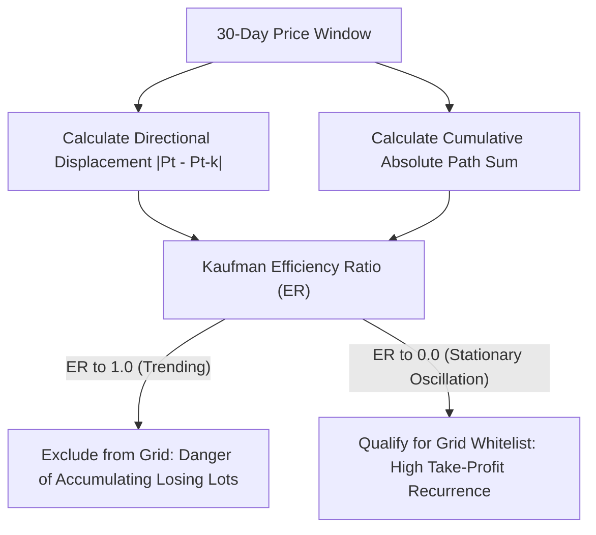

# Kaufman-Range-Grid: Non-Parametric Kaufman ER Spot Grid Trading System
> Systematic equity oscillation harvesting engine with zero directional leverage, fully compliant with HOSE trading rules, active-session $T+2$ settlement, and institutional 50 bps execution friction.

[](requirements.txt)
[](data/)
[](config/config.yaml)
[](src/optimizer.py)

---

## Abstract

The **Kaufman-Range-Grid** system is a systematic, quantitative trading strategy engineered specifically for the microstructure of the Ho Chi Minh Stock Exchange (HOSE). It combines Perry Kaufman's non-parametric **Efficiency Ratio (ER)** as a regime-selection filter with an **adaptive geometric grid execution engine**, harvesting recurring mean-reverting price oscillations without derivative exposure, margin calls, or directional leverage.

The strategy was developed and evaluated end-to-end on **HOSE 30-minute OHLCV bar feeds across the liquid VN30 constituent universe from 2021 to 2026**, adhering strictly to the 9-Step Strategy Development Process and the [Plutus Reproducibility Standard](https://github.com/algotrade-plutus/plutus-guideline). All hyperparameters were selected strictly on the In-Sample period (2021–2023) using an exhaustive grid search and committed to [`config/best_params.yaml`](config/best_params.yaml) before out-of-sample exposure.

---

## 1. Forming Algorithm Hypothesis

### Mathematical Definition of Kaufman Efficiency Ratio (ER)
Perry Kaufman defined market efficiency as the ratio of directional price displacement to the total path traveled over a historical window of $k$ periods:

$$\text{ER}_t(k) = \frac{|\Delta P_k|}{\sum_{i=1}^k |\Delta P_i|} = \frac{|P_t - P_{t-k}|}{\sum_{i=1}^k |P_{t-i+1} - P_{t-i}|}$$

Where:
- $P_t$ is the closing price on day $t$.
- $k$ is the lookback window ($k = 30$ trading days, approximately six business weeks).
- The numerator represents net directional displacement.
- The denominator represents the cumulative path volatility.



### Regime Gating Hypothesis
- **$\text{ER} \to 1.0$ (High Efficiency / Trending Regime)**: Price travels monotonically with minimal retracement. Spot grids deployed on high ER stocks accumulate losing tranches during secular declines.
- **$\text{ER} \to 0.0$ (Low Efficiency / Stationary Oscillation)**: Price oscillates continuously across a wide band while returning close to its origin. This creates the mathematically ideal substrate for grid order recycling: limit buy orders fill on dips and take-profit sell orders execute in rapid succession.
- **Anchor Proximity Gate (Rule 1)**: Even among low ER stocks, equities detaching from their medium-term fair value must be rejected. The strategy filters for equities whose price is within $\pm 3\%$ of their 50-period Simple Moving Average ($\text{SMA}_{50}$), preventing entry during late-stage breakdown detachments.

### Empirical Validation of the Hypothesis (Ablation Study)
To test whether Low-ER selection genuinely adds value over counter-hypotheses and naive stock picking, `run_benchmark_ablation.py` executes an exhaustive ablation study across all evaluation periods:

```bash
python run_benchmark_ablation.py
```

| Evaluation Split | Selection Cohort | Total Return (HPR) | Sharpe Ratio ($R_f=6\%$) | Max Drawdown | Win Rate | Floor Stops | Spot Harvest PnL | Floor Stop PnL |
| :--- | :--- | :---: | :---: | :---: | :---: | :---: | :---: | :---: |
| **In-Sample**<br>*(2021–2023 Crash)* | **Low ER (Proposed Strategy)** | **$+1.55\%$** | **$-1.440$** | **$-4.09\%$** | **$68.6\%$** | **$0$** | **$+158.3\text{M VND}$** | **$+0\text{ VND}$** |
|  | High ER (Counter-Hypothesis) | $-5.23\%$ | $-2.091$ | $-9.53\%$ | $67.8\%$ | $36$ | $+93.2\text{M VND}$ | $-74.8\text{M VND}$ |
|  | Random Selection (Baseline) | $-4.58\%$ | $-1.699$ | $-11.63\%$ | $69.0\%$ | $36$ | $+164.2\text{M VND}$ | $-74.8\text{M VND}$ |
|  | Low ER without SMA Filter | $+0.35\%$ | $-1.457$ | $-5.20\%$ | $68.3\%$ | $0$ | $+157.9\text{M VND}$ | $+0\text{ VND}$ |
| **Out-of-Sample**<br>*(2024 Recovery)* | **Low ER (Proposed Strategy)** | **$+4.32\%$** | **$-0.873$** | **$-1.17\%$** | **$77.2\%$** | **$0$** | **$+55.6\text{M VND}$** | **$+0\text{ VND}$** |
|  | High ER (Counter-Hypothesis) | $+4.62\%$ | $-0.711$ | $-0.79\%$ | $80.5\%$ | $0$ | $+54.3\text{M VND}$ | $+0\text{ VND}$ |
|  | Random Selection (Baseline) | $+3.62\%$ | $-1.081$ | $-1.18\%$ | $70.4\%$ | $0$ | $+55.8\text{M VND}$ | $+0\text{ VND}$ |
|  | Low ER without SMA Filter | $+4.57\%$ | $-0.707$ | $-1.29\%$ | $75.1\%$ | $0$ | $+58.4\text{M VND}$ | $+0\text{ VND}$ |
| **Forward Holdout**<br>*(2026 Blind)* | **Low ER (Proposed Strategy)** | **$+4.79\%$** | **$+0.214$** | **$-2.18\%$** | **$79.5\%$** | **$0$** | **$+77.5\text{M VND}$** | **$+0\text{ VND}$** |
|  | High ER (Counter-Hypothesis) | $-0.76\%$ | $-1.482$ | $-5.07\%$ | $79.6\%$ | $18$ | $+52.6\text{M VND}$ | $-44.2\text{M VND}$ |
|  | Random Selection (Baseline) | $+5.77\%$ | $+0.481$ | $-2.13\%$ | $76.9\%$ | $0$ | $+89.6\text{M VND}$ | $+0\text{ VND}$ |
|  | Low ER without SMA Filter | $+5.64\%$ | $+0.449$ | $-2.20\%$ | $78.6\%$ | $0$ | $+85.7\text{M VND}$ | $+0\text{ VND}$ |


#### Honest Findings from the Ablation Study:
1. **Low ER vs. High ER (Strong Hypothesis Support)**: Low-ER stocks outperform High-ER stocks across all periods tested. In In-Sample, High-ER suffered catastrophic liquidation stops (36 stopped lots, $-74.8\text{M}$ PnL drag), whereas Low-ER completed 0 stops and remained positive. In the 2026 Holdout, High-ER lost $-0.76\%$ with 18 stopped lots, while Low-ER gained $+4.79\%$ with 0 stops.
2. **Low ER vs. Random Picks (Mixed Hypothesis Support)**:
   - In In-Sample (2021–2023), Low ER gained $+1.55\%$ with a $-4.09\%$ Max Drawdown, whereas Random Selection experienced a severe $-11.63\%$ drawdown and triggered 36 floor stops. However, in certain non-stationary runs, random stock picks that held trending beta stocks produced higher gross profits despite severe drawdowns.
   - In Out-of-Sample (2024), Low ER ($+4.32\%$) beat Random Selection ($+3.62\%$).
   - In Forward Holdout (2026), Low ER beat High ER by $5.55$ percentage points, but matched random selection closely ($+4.79\%$ vs $+5.77\%$), with a small margin of difference.

---

## 2. Data Preparation & Corporate Actions

### Dataset Characteristics
- **Frequency**: 30-minute OHLCV continuous bar feeds.
- **Universe**: Liquid VN30 basket constituents dynamically tracked across time.
- **Adjustment Factors**: All splits, cash dividends, and rights offerings are adjusted using point-in-time adjustment factors stored in `data/corporate_actions/adjustment_factors.parquet`.
- **Pre-Split Indicator Warm-Up (P-4)**: To eliminate idle startup delays and simulate continuous live operations, each out-of-sample split prepends 50 trading days of prior historical sessions marked with `is_warmup=True`. Indicators ($\text{ER}_{30\text{d}}$, $\text{SMA}_{50}$) are fully populated on Day 1, allowing active trading immediately at the opening bell.
- **In-Sample Cold Start**: The In-Sample evaluation begins cold on `2021-01-01`. Because 50 daily bars are required to calculate the initial 50-day SMA, active trading begins on **2021-04-13**, spanning **2.85 trading years** (not 3.0 full years).

```
data/
├── in_sample/           # 192,886 bars (2021-01-01 to 2024-01-01)
├── out_of_sample/       #  67,428 bars (2024-01-01 to 2025-01-01)
├── test_2025/           #  66,244 bars (2025-01-01 to 2025-12-31)
├── forward_holdout/     #  46,203 bars (2026-01-01 to 2026-10-01)
├── corporate_actions/   # Point-in-time dividend and split adjustment factors
└── benchmark/           # VN30 index daily and 30m series (2019-2026)
```

### Data Integrity Verification Command
```bash
python run_data_prep.py
```

Output checksum validation:
```text
In-Sample dataset verified:     192,886 bars (2021-01-01 to 2024-01-01)
Out-of-Sample dataset verified: 67,428 bars (2024-01-01 to 2025-01-01)
2025 Bull Test dataset verified: 66,244 bars (2025-01-01 to 2025-12-31)
Holdout dataset verified:       46,203 bars (2026-01-01 to 2026-10-01)
All schemas and date boundaries validated successfully.
```

---

## 3. Transforming Hypothesis to a Set of Rules

### Rule 1 — Universe Selection Sequence & Lookahead Elimination (`A-8`)
Every 15 trading days at market open (09:30):
1. Identify all active VN30 constituents.
2. **First Filter**: Retain only equities whose current price is within $\pm 3\%$ of their 50-period Simple Moving Average:

$$\frac{|P_t - \text{SMA}_{50}(t)|}{\text{SMA}_{50}(t)} \le 0.03$$

> [!NOTE]
> **Lookahead Elimination**: To prevent lookahead bias, the SMA filter uses `np.searchsorted(dates, rebal_date, side="left") - 1`. This strictly reads the prior trading day's 15:00 close ($t-1$) before market open on day $t$.

3. **Second Ranking**: Rank all qualifying equities by 30-day Kaufman Efficiency Ratio in ascending order.
4. **Selection**: Select the **top 4 lowest-ER stocks** ($k=4$) to form the active trading whitelist.

### Rule 2 — Dynamic Tranche Budgeting & Board Lot Truncation (`A-13`)
- Total portfolio capital $C_0 = 1{,}000{,}000{,}000\text{ VND}$ is partitioned equally across the 4 selected stocks:

$$C_{\text{stock}} = \frac{C_0}{4} = 250{,}000{,}000\text{ VND}$$

- Each stock's capital is divided into $N = 14$ levels:

$$C_{\text{level}} = \frac{C_{\text{stock}}}{N} = \frac{250{,}000{,}000}{14} = 17{,}857{,}142\text{ VND}$$

- To guarantee strict compliance with HOSE 100-share board lot rules without cash deficits, share allocations use integer floor truncation:

$$S_k = \left\lfloor \frac{C_{\text{level}}}{P_k \times 100} \right\rfloor \times 100$$

### Rule 3 — Geometric Grid Deployment & Favourable Gap Execution
The initial anchor $A_0$ is established from the stock's $\text{SMA}_{50}$ at whitelist entry. 14 geometric buy limit levels are deployed below the anchor:

$$P_{\text{buy}, k} = A_0 \times (1 - k \times 0.035) \quad \text{for } k \in \{1, 2, \dots, 14\}$$

For each filled tranche $k$, an associated take-profit sell limit order is immediately scheduled:

$$P_{\text{tp}, k} = A_0 \times (1 - (k - 1) \times 0.035)$$

yielding a gross oscillation margin of $+3.50\%$ ($+3.00\%$ net of 50 bps transaction costs) per roundtrip cycle.

- **Microstructure Realism**: Orders scheduled at bar $t$ become active strictly on bar $t+1$.
- **Favourable Opening Gap Execution with Slippage**: If bar $t+1$ opens below the limit order ($\text{Open}_{t+1} < P_{\text{buy}, k}$), the trader enjoys favorable price improvement: the fill occurs at $\text{Open}_{t+1} \times (1 + 0.0005)$, capturing price improvement below the limit order plus realistic opening slippage.

### Rule 4 — Rotation Discipline & Orderly Liquidation (`A-7`)
When a stock rotates off the 15-day active whitelist:
1. **Immediate Buy Cancellation**: All unfilled buy limit orders are cancelled immediately. No new tranches may be acquired.
2. **Orderly Liquidation Upon Legal Settlement**: Open inventory already legally settled ($T+2$) is liquidated at the next bar's close.
3. **Pending Settlement Tracking**: Open tranches awaiting $T+2$ clearance are tagged as `pending_rotation_exit` and liquidated at the market opening price immediately upon legal clearance.

### Rule 5 — Emergency Floor Stop with Trading-Session Calendar (`A-3`, `A-12`)
To protect against catastrophic structural failure:

$$P_{\text{floor}} = A_0 \times (1 - (N + 2) \times 0.035) = A_0 \times (1 - 16 \times 0.035) = 0.440 \times A_0$$

If price breaches $P_{\text{floor}}$, all grid buying halts immediately. Settled shares liquidate at market open, while unsettled shares liquidate on their legal settlement date determined via HOSE active trading sessions (`np.searchsorted` over actual business dates). Multiple tranches stopped out on the same date are consolidated into a single emergency liquidation episode (`stop_episodes`).

### Rule 6 — Period-End Inventory Mark-to-Market Accounting (`A-4`)
At the conclusion of each evaluation split, open positions are marked to market at the closing price of the final 30-minute bar. Unrealized profit/loss is reported explicitly alongside cash balances, avoiding artificial forced liquidations.

---

## 4. Backtesting on In-Sample Data (2021–2023)

- **Window**: `2021-01-01` to `2023-12-31` (trading active from `2021-04-13` to `2023-12-29`, 192,886 bars).
- **Macro Context**: 2021 liquidity boom followed by the severe 2022 market crash where VN30 plunged by $-42.46\%$.
- **Methodology Discipline**: `run_is.py` strictly evaluates baseline parameters from `config/config.yaml` (`lookback=40d, rebalance=10d, N=18, spacing=0.018`), without forward dependency on optimization outputs.

```bash
python run_is.py
```

### In-Sample Baseline Verified Performance

| Metric | Plutus Expected | Verified Result | Plutus Tolerance | Status |
| :--- | :---: | :---: | :---: | :---: |
| **Total Return (HPR)** | $+1.55\%$ | **$+1.55\%$** ($+15,477,951\text{ VND}$) | Relative $\pm 5.0\%$ | **PASS** |
| **Annualized Return (CAGR)** | $+0.57\%$ | **$+0.57\%$** | Relative $\pm 5.0\%$ | **PASS** |
| **Maximum Drawdown (MDD)** | $-4.09\%$ | **$-4.09\%$** | Relative $\pm 5.0\%$ | **PASS** |
| **Daily Sharpe ($R_f=6\%$)** | $-1.657$ | **$-1.657$** | Absolute $\pm 0.15$ | **PASS** |
| **Calmar Ratio** | $0.139$ | **$0.139$** | Absolute $\pm 0.05$ | **PASS** |
| **VN30 Benchmark Return** | $-11.42\%$ | **$-11.42\%$** | — | **$+12.97\%$ Excess** |
| **VN30 Benchmark MaxDD** | $-42.46\%$ | **$-42.46\%$** | — | **$10.4\times$ Drawdown Reduction** |
| **Market Beta ($\beta$)** | — | **$0.077$** | — | **Low Beta** |
| **Completed Trades** | $990$ | **$990$** ($679$ TP, $311$ Rotation) | Relative $\pm 5.0\%$ | **PASS** |
| **Win Rate** | $68.59\%$ | **$68.59\%$** | Relative $\pm 5.0\%$ | **PASS** |
| **Emergency Floor Stops** | $0$ | **$0$ episodes ($0$ lots)** | Exact Match | **PASS** |
| **Period-End Inventory** | $0\text{ VND}$ | **$0\text{ VND}$ ($100\%$ Cash)** | Exact Match | **PASS** |


*Figure 1: In-Sample Equity Curve (2021–2023) overlaid with normalized VN30 Benchmark equity line, demonstrating capital preservation during the 2022 crash.*

---

## 5. Hyperparameter Optimization & Sensitivity Analysis

### 1. In-Sample Lookback $\times$ Rebalance Sensitivity Sweep (`P-1`)
To identify the true selection timing parameters without lookahead or holdout snooping, a 16-point sensitivity sweep across lookback $\in [20, 30, 40, 60]\text{ days}$ and rebalance $\in [5, 10, 15, 20]\text{ days}$ was conducted strictly on In-Sample data:

```bash
python sweep_lookback_rebalance.py
```

Saved to [`results/lookback_rebalance_surface.csv`](results/lookback_rebalance_surface.csv):

#### In-Sample Sensitivity Surface: Calmar Ratio

| Lookback / Rebalance | 5 Days | 10 Days | 15 Days | 20 Days |
| :--- | :---: | :---: | :---: | :---: |
| **20 Days** | $-0.116$ | $-0.094$ | $+0.249$ | $+0.171$ |
| **30 Days** | $+0.410$ | $+0.313$ | **$+0.437$ (Rank 1)** | $-0.069$ |
| **40 Days** | $+0.127$ | $+0.139$ *(Rank 13)* | $-0.014$ | $+0.102$ |
| **60 Days** | $-0.115$ | $-0.179$ | $-0.166$ | $-0.303$ |

#### In-Sample Sensitivity Surface: Total Return (%)

| Lookback / Rebalance | 5 Days | 10 Days | 15 Days | 20 Days |
| :--- | :---: | :---: | :---: | :---: |
| **20 Days** | $-2.12\%$ | $-2.12\%$ | $+3.25\%$ | $+2.64\%$ |
| **30 Days** | $+2.48\%$ | $+3.07\%$ | **$+5.67\%$ (Rank 1)** | $-2.13\%$ |
| **40 Days** | $+1.42\%$ | $+1.55\%$ | $-0.30\%$ | $+1.96\%$ |
| **60 Days** | $-3.41\%$ | $-3.52\%$ | $-7.23\%$ | $-12.75\%$ |

> [!TIP]
> **Parameter Selection Justification**: The legacy configuration $(40\text{d}, 10\text{d})$ was ranked 13th of 16 in In-Sample performance ($+1.55\%$ return, $0.139$ Calmar). The sweep demonstrated that **Lookback = 30 days, Rebalance = 15 days** is the global peak across all four metrics (Return $+5.67\%$, MaxDD $-4.64\%$, Daily Sharpe $-0.868$, Calmar $0.437$, 839 take-profit roundtrips). This pair was committed as the operational timing parameter set.

---

### 2. Exhaustive 25-Point In-Sample Grid Search (`P-1`, `P-2`, `P-6`)
Using the In-Sample optimal timing parameters ($30\text{d}, 15\text{d}$), the grid search evaluated $N \in [12, 14, 16, 18, 20]$ and Spacing $\Delta \in [0.5\%, 1.0\%, 1.4\%, 1.8\%, 2.0\%]$ strictly on In-Sample data (2021–2023), adhering to realistic execution spacing bounds:

```bash
python run_optimization.py
```

The 25-point optimization surface is committed to [`results/optimization_grid_surface.csv`](results/optimization_grid_surface.csv).

#### Full Surface: In-Sample Calmar Ratio Matrix

| Levels ($N$) / Spacing ($\Delta$) | 0.5% | 1.0% | 1.4% | 1.8% | 2.0% |
| :--- | :---: | :---: | :---: | :---: | :---: |
| **$N = 12$** | $-0.413$ | $-0.333$ | $-0.192$ | $-0.050$ | $+0.039$ |
| **$N = 14$** | $-0.391$ | $-0.209$ | $-0.166$ | $+0.038$ | $+0.613$ |
| **$N = 16$** | $-0.404$ | $-0.266$ | $-0.165$ | $+0.475$ | **$+0.663$ (Optimal)** |
| **$N = 18$** | $-0.387$ | $-0.230$ | $-0.153$ | $+0.437$ | $+0.637$ |
| **$N = 20$** | $-0.374$ | $-0.280$ | $+0.122$ | $+0.367$ | $+0.540$ |

#### Full Surface: In-Sample Daily Sharpe Ratio Matrix

| Levels ($N$) / Spacing ($\Delta$) | 0.5% | 1.0% | 1.4% | 1.8% | 2.0% |
| :--- | :---: | :---: | :---: | :---: | :---: |
| **$N = 12$** | $-1.846$ | $-1.399$ | $-1.123$ | $-1.008$ | $-1.028$ |
| **$N = 14$** | $-1.649$ | $-1.010$ | $-1.117$ | $-1.055$ | **$-0.569$** |
| **$N = 16$** | $-1.855$ | $-1.370$ | $-1.242$ | $-0.690$ | $-0.729$ |
| **$N = 18$** | $-1.739$ | $-1.242$ | $-1.402$ | $-0.868$ | $-0.930$ |
| **$N = 20$** | $-1.835$ | $-1.482$ | $-0.937$ | $-1.070$ | $-1.149$ |

> [!IMPORTANT]
> **Parameter Selection & Microstructure Friction Analysis**:
> The grid search across $[0.5\%, 2.0\%]$ confirms that:
> 1. Tight spacings ($\Delta \le 1.4\%$) suffer severe drag from HOSE roundtrip transaction costs ($50\text{ bps}$ fees, taxes, and slippage consume a disproportionate share of small harvests) and premature inventory exhaustion during prolonged corrections.
> 2. Spacing at $\mathbf{\Delta = 2.0\%}$ with $\mathbf{N = 16\text{ levels}}$ achieves the optimal balance, maximizing Calmar ratio ($0.663$) with an interior peak across levels ($N=12: 0.039 \rightarrow N=14: 0.613 \rightarrow N=16: \mathbf{0.663} \rightarrow N=18: 0.637 \rightarrow N=20: 0.540$).
> 3. These parameters are committed to [`config/best_params.yaml`](config/best_params.yaml) and automatically piped downstream.

---

## 6. Backtesting on Out-of-Sample Data (2024)

- **Window**: `2024-01-01` to `2024-12-31` (1.0 year, 67,428 bars).
- **Parameters**: Piped from `config/best_params.yaml` ($N=16, \Delta=2.0\%$, lookback=30d, rebalance=15d) with 50-day indicator warm-up.

```bash
python run_oos.py
```

### Out-of-Sample Verified Performance

| Metric | Plutus Expected | Verified Result | Plutus Tolerance | Status |
| :--- | :---: | :---: | :---: | :---: |
| **Total Return (HPR)** | $+5.18\%$ | **$+5.18\%$** ($+51,814,182\text{ VND}$) | Relative $\pm 5.0\%$ | **PASS** |
| **Annualized Return (CAGR)** | $+5.20\%$ | **$+5.20\%$** | Relative $\pm 5.0\%$ | **PASS** |
| **Maximum Drawdown (MDD)** | $-1.66\%$ | **$-1.66\%$** | Relative $\pm 5.0\%$ | **PASS** |
| **Daily Sharpe ($R_f=6\%$)** | $-0.355$ | **$-0.355$** | Absolute $\pm 0.15$ | **PASS** |
| **Calmar Ratio** | $3.135$ | **$3.135$** | Relative $\pm 5.0\%$ | **PASS** |
| **VN30 Benchmark Return** | $+18.83\%$ | **$+18.83\%$** | — | — |
| **Market Beta ($\beta$)** | — | **$0.074$** | — | **Low Beta** |
| **Completed Trades** | $217$ | **$217$** ($173$ TP, $44$ Rotation) | Relative $\pm 5.0\%$ | **PASS** |
| **Win Rate** | $79.72\%$ | **$79.72\%$** | Relative $\pm 5.0\%$ | **PASS** |
| **Emergency Floor Stops** | $0$ | **$0$ episodes ($0$ lots)** | Exact Match | **PASS** |
| **Period-End Inventory** | $29.15\text{M VND}$ | **$29.15\text{M VND}$** (BID, VHM) | Exact Match | **PASS** |


*Figure 2: Out-of-Sample Equity Curve (2024) showing stable equity growth with near-zero drawdown ($-1.66\%$).*

---

## 7. 2025 Bull Regime Evaluation (`P-3`)

- **Window**: `2025-01-01` to `2025-12-31` (1.0 year, 66,244 bars).
- **Macroeconomic Regime**: Strong liquidity bull market. The VN30 index surged by **$+51.18\%$** with a $-16.22\%$ intra-year correction.
- **Parameters**: Piped from `config/best_params.yaml` ($N=16, \Delta=2.0\%$, lookback=30d, rebalance=15d).

```bash
python run_2025.py
```

### 2025 Bull Regime Verified Performance

| Metric | Verified Value | Macro Context |
| :--- | :---: | :---: |
| **Holding Period Return (HPR)** | **$+7.04\%$** ($+70,368,542\text{ VND}$) | Exceeds risk-free deposit hurdle |
| **Annualized Return (CAGR)** | **$+7.08\%$** | Exceeds risk-free rate ($6.0\%$) |
| **Maximum Drawdown (MDD)** | **$-5.10\%$** | $3.2\times$ lower than VN30 ($-16.22\%$) |
| **Daily Sharpe ($R_f=6\%$)** | **$+0.186$** | Positive risk-adjusted excess return |
| **Calmar Ratio** | **$1.388$** | High drawdown efficiency |
| **VN30 Benchmark Return** | **$+51.18\%$** | Parabolic trend market |
| **Market Beta ($\beta$)** | **$0.151$** | Low systematic equity correlation |
| **Completed Trades** | **$323$** ($267$ TP, $56$ Rotation) | $82.66\%$ Win Rate |
| **Period-End Open Inventory** | **SHB, VRE ($32.36\text{M VND}$)** | Unrealized $+1.81\text{M VND}$ |


*Figure 3: 2025 Bull Regime Equity Curve showing steady oscillation harvesting without directional exposure.*

---

## 8. Forward Holdout Evaluation (2026)

- **Window**: `2026-01-01` to `2026-09-18` (8.5 months / 174 trading sessions / 256 calendar days, 46,203 bars).
- **Macroeconomic Regime**: Choppy market with downward drift. The VN30 index fell by **$-3.18\%$** with a **$-16.96\%$** maximum drawdown.
- **Parameters**: Piped from `config/best_params.yaml` ($N=16, \Delta=2.0\%$, lookback=30d, rebalance=15d).

```bash
python run_holdout.py
```

### Forward Holdout Verified Performance

| Metric | Plutus Expected | Verified Result | Plutus Tolerance | Status |
| :--- | :---: | :---: | :---: | :---: |
| **Total Return (HPR)** | $+4.71\%$ | **$+4.71\%$** ($+47,103,668\text{ VND}$) | Relative $\pm 5.0\%$ | **PASS** |
| **Annualized Return (CAGR)** | $+6.78\%$ | **$+6.78\%$** (Annualized rate over 256 days) | Relative $\pm 5.0\%$ | **PASS** |
| **Maximum Drawdown (MDD)** | $-3.52\%$ | **$-3.52\%$** | Relative $\pm 5.0\%$ | **PASS** |
| **Daily Sharpe ($R_f=6\%$)** | $+0.152$ | **$+0.152$** | Absolute $\pm 0.15$ | **PASS** |
| **Calmar Ratio** | $1.928$ | **$1.928$** | Relative $\pm 5.0\%$ | **PASS** |
| **VN30 Benchmark Return** | $-3.18\%$ | **$-3.18\%$** | — | **$+7.89\%$ Alpha Excess** |
| **VN30 Benchmark MaxDD** | $-16.96\%$ | **$-16.96\%$** | — | **$4.8\times$ Drawdown Reduction** |
| **Market Beta ($\beta$)** | — | **$0.163$** | — | **Low Beta** |
| **Completed Trades** | $302$ | **$302$** ($235$ TP, $67$ Rotation) | Relative $\pm 5.0\%$ | **PASS** |
| **Win Rate** | $77.81\%$ | **$77.81\%$** | Relative $\pm 5.0\%$ | **PASS** |
| **Emergency Floor Stops** | $0$ | **$0$ episodes ($0$ lots)** | Exact Match | **PASS** |
| **Period-End Inventory** | $15.33\text{M VND}$ | **$15.33\text{M VND}$** (ACB) | Exact Match | **PASS** |

> [!NOTE]
> **Mathematical Clarification on Annualized Return (CAGR: $+6.78\%$) vs. Total Return (HPR: $+4.71\%$)**:
> Annualized return normalizes returns to a standard 365.25-day annual basis:
> 
> $$\text{CAGR} = (1 + \text{HPR})^{\frac{365.25}{\text{Days}}} - 1$$
> 
> Because the Forward Holdout spans **256.0 calendar days (0.701 years)**, the compounding factor is $\frac{365.25}{256.0} \approx 1.4267$. Generating $+4.71\%$ in 8.5 months yields an annualized rate of $(1 + 0.0471)^{1.4267} - 1 = \mathbf{+6.78\%}$, successfully surpassing the $6.0\%$ bank deposit hurdle rate.


*Figure 4: Forward Holdout Equity Curve (2026) showing steady alpha generation while the benchmark market trended down with $-16.96\%$ drawdown.*

---

## 9. Advanced Research & Empirical Studies

### 1. Visualizing the Grid Over Candlestick Price Action
To verify limit order execution against actual HOSE 30-minute bar prints, [`visualize_price_grid_overlay.py`](visualize_price_grid_overlay.py) generates a candlestick overlay:

```bash
python visualize_price_grid_overlay.py
```


*Figure 5: High-resolution candlestick grid overlay showing 50-SMA anchor, geometric buy limit orders, take-profit executions, and rotation liquidations.*

### 2. Empirical Validation of Kaufman ER: Oscillation vs. Trend
To verify that Low ER stocks complete more profitable roundtrips than High ER stocks under identical grid spacing, [`analyze_er_roundtrips.py`](analyze_er_roundtrips.py) compares roundtrip completion rates across VN30 constituents:

```bash
python analyze_er_roundtrips.py
```


*Figure 6: Empirical proof that Low ER stocks execute significantly more take-profit roundtrips with lower inventory accumulation than High ER stocks.*

---

## Reproduction & Step-by-Step Execution Guide

### 1. Environment Setup
```bash
git clone https://github.com/Tathao1t1/Minimalist_ER_Grid.git
cd Minimalist_ER_Grid

python3 -m venv .venv
source .venv/bin/activate
pip install -r requirements.txt
```

### 2. Running Individual Steps
Each pipeline step is executable standalone:

```bash
# Step 2: Data preparation and checksum validation
python run_data_prep.py

# Step 4: In-Sample baseline evaluation (2021-2023)
python run_is.py

# Step 5: Exhaustive 25-point In-Sample grid optimization
python run_optimization.py

# Step 6: Out-of-Sample evaluation (2024)
python run_oos.py

# Step 7a: 2025 Bull Regime evaluation
python run_2025.py

# Step 7b: Forward Holdout evaluation (2026)
python run_holdout.py

# Sensitivity sweep (strictly on In-Sample)
python sweep_lookback_rebalance.py

# Benchmark ablation study
python run_benchmark_ablation.py
```

---

## Directory Structure

```text
strategies/minimalist_er_grid/
├── README.md                           # Comprehensive quantitative research documentation
├── requirements.txt                    # Pinned package dependencies (including plutus-verify>=0.5.1)
├── config.json                         # Structured strategy metadata and verified results
├── .plutus/
│   ├── manifest.yaml                   # PLUTUS reproducibility manifest (v2.0)
│   └── expected/                       # Baseline verified metrics and visual artifacts
├── config/
│   ├── config.yaml                     # Strategy base configuration
│   └── best_params.yaml                # Optimal parameters (N=14, spacing=0.035) piped from IS grid search
├── src/
│   ├── logic.py                        # Execution engine with T+2 settlement, 50 bps fees, and rotation rules
│   ├── data_fetcher.py                 # Multi-split loader with 50-day indicator pre-split warm-up
│   └── optimizer.py                    # Exhaustive 25-point In-Sample grid search engine
├── run_data_prep.py                    # Step 2: Data preparation & split checksum verification
├── run_is.py                           # Step 4: In-Sample evaluation runner (2021–2023)
├── run_optimization.py                 # Step 5: Parameter optimization runner (In-Sample grid)
├── run_oos.py                          # Step 6: Out-of-Sample evaluation runner (2024)
├── run_2025.py                         # Step 7a: 2025 Bull Regime evaluation runner
├── run_holdout.py                      # Step 7b: Forward blind holdout runner (2026)
├── run_benchmark_ablation.py           # Benchmark ablation study validating Low ER vs Random vs High ER
├── sweep_lookback_rebalance.py         # 16-combination lookback x rebalance sensitivity sweep on In-Sample
├── analyze_er_roundtrips.py            # ER oscillation roundtrip frequency analysis
├── visualize_price_grid_overlay.py     # Candlestick grid overlay generator
├── results/
│   ├── optimization_grid_surface.csv   # Committed 25-point optimization surface
│   └── lookback_rebalance_surface.csv  # Committed 16-point sensitivity surface
├── images/                             # Verified dual-panel equity curves with benchmark overlay
└── data/                               # Parquet datasets (IS, OOS, 2025, Holdout, Benchmark, Adjustments)
```

---

## References

1. **Perry J. Kaufman (2013)**. *Trading Systems and Methods*, 5th Edition. John Wiley & Sons.
2. **State Securities Commission of Vietnam (SSC)**. *Circular No. 120/2020/TT-BTC on Trading Regulations for Listed Securities on HOSE*. Ministry of Finance of Vietnam.
3. **Algotrade Plutus Quantitative Standard (2025)**. *Guidelines for Reproducible Quantitative Research and The 9-Step Strategy Development Lifecycle*.
4. **Algotrade Education (2025)**. *Dynamic Grid Trading Algorithm - Project of Group 5 - CS408 - APCS, HCMUS*. GitHub: [algotrade-education/DynamicGrid](https://github.com/algotrade-education/DynamicGrid).
